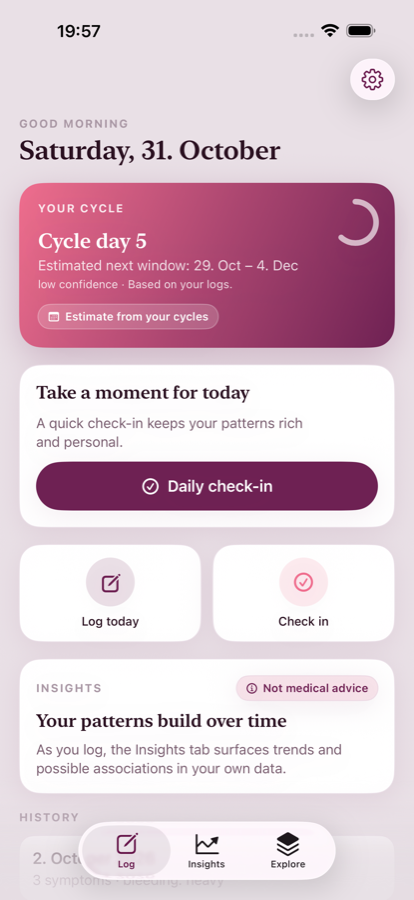
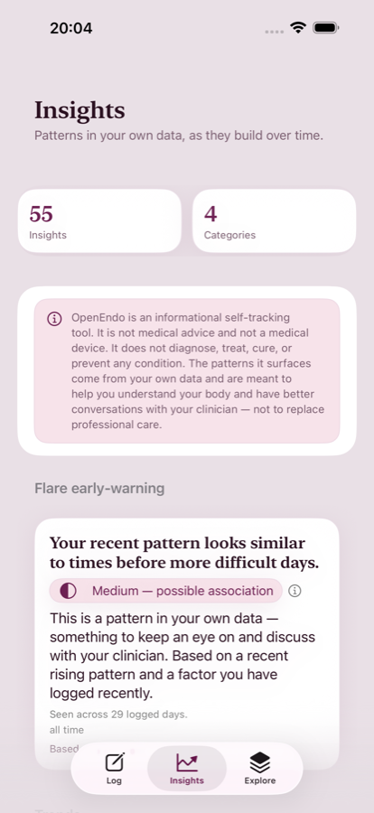
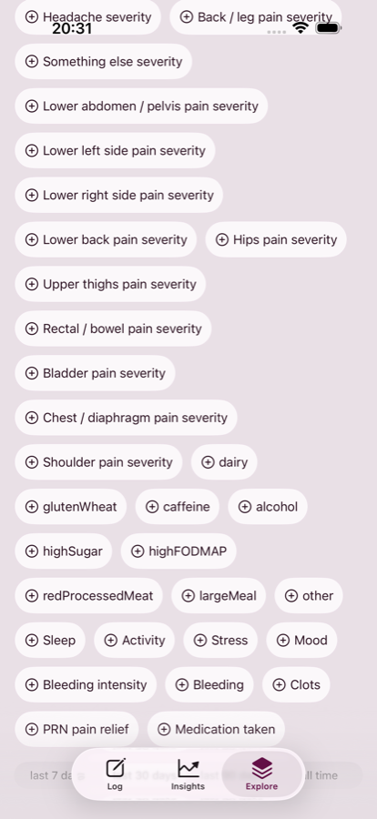
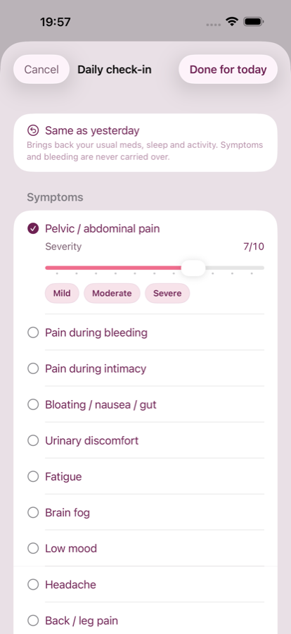
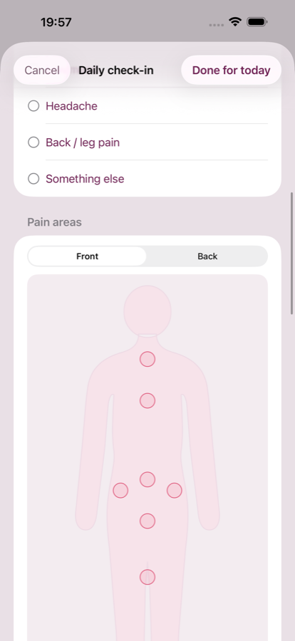
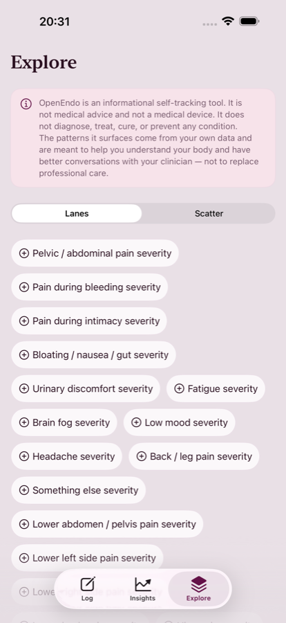
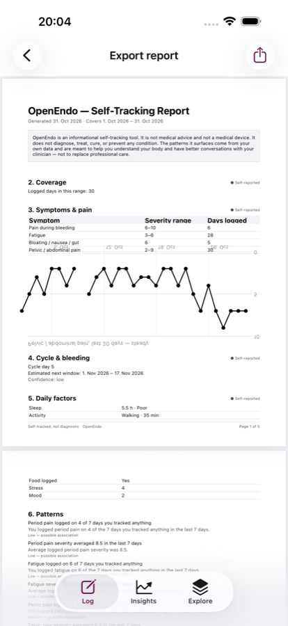
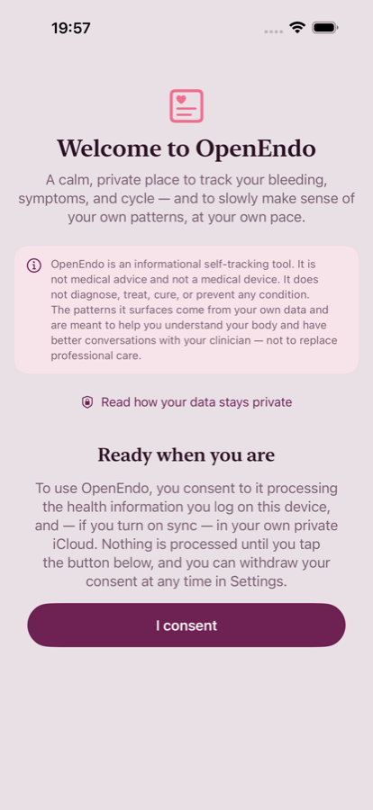

<p align="center">
  
  
  
</p>

<h1 align="center">OpenEndo</h1>

<p align="center">
  A free, open-source, privacy-first endometriosis symptom tracker for iPhone and Android.<br>
  Everything stays on your device. No account, no backend, no tracking.
</p>

<p align="center">
  <a href="https://github.com/HanSur94/endo-app">Source code</a> ·
  <a href="privacy.md">Privacy policy</a> ·
  <a href="https://github.com/HanSur94/endo-app/issues">Support</a>
</p>

---

## What it does

**A check-in that takes a minute.** Log pain, bleeding, gut, energy, sleep, mood, meds and stress for
the day — or skip the symptoms and just confirm the day happened.

**Patterns from your own logs.** OpenEndo compares the days you logged and shows where two things
moved together, with a confidence marker and the number of days behind it. Nothing is inferred
about you that you did not enter.

**Explore without a claim.** Lanes and a scatter view let you look at one signal against another
across weeks — the raw material for a better conversation with your clinician.

**A report you can hand over.** Export a PDF for a fixed date range and take it to an appointment.

**Yours to keep.** Data is stored locally on the device, backed up through your own iCloud or Android
backup. There is no server to send it to, no analytics SDK, and no account to create.

## Screenshots

| | | |
|---|---|---|
|  |  |  |
| Home — cycle estimate, check-in, history | Daily check-in | Symptoms and severity |
|  |  |  |
| Insights — patterns and confidence | Explore — lanes and scatter | One lane per signal |
|  |  |  |
| Exportable PDF report | Consent before anything is stored |  |

Screenshots are captured from the real app with seed data by
[`StoreScreenshotTour`](https://github.com/HanSur94/endo-app/blob/main/Tests/EndoAppUITests/StoreScreenshotTour.swift).

## Build it yourself

The iOS app builds with Xcode and XcodeGen; the Android app is Kotlin, Compose and Room. Both are
plain, dependency-light codebases with the full test suites in the repository.

```sh
git clone https://github.com/HanSur94/endo-app.git
cd endo-app && xcodegen generate
open EndoApp.xcodeproj
```

See the [README](https://github.com/HanSur94/endo-app#readme) for the Android build, the test
commands and the per-platform requirements.

## Licence

MIT — see [LICENSE](https://github.com/HanSur94/endo-app/blob/main/LICENSE).

---

**OpenEndo is a wellness self-tracking tool. It is not a medical device and does not diagnose,
treat, cure or prevent any condition. It is not a substitute for medical advice.**
